<div align="center">



**Software engineer for performance and backend systems at ION Trading.**<br>
I cut startup times, heap sizes and query times in production Java services, and chase down the bugs behind P1s.

[Portfolio](https://anishaga.github.io) &nbsp;·&nbsp; [LinkedIn](https://www.linkedin.com/in/anishaga/) &nbsp;·&nbsp; [LeetCode](https://leetcode.com/anishaga/) &nbsp;·&nbsp; [Email](mailto:anishaga2001@gmail.com)

</div>

---

### The numbers

<table align="center">
<tr>
<td align="center"><h2>~85%</h2>less startup time<br><sub>core position-valuation service</sub></td>
<td align="center"><h2>~62%</h2>less heap<br><sub>26 GB down to 10 GB</sub></td>
<td align="center"><h2>~49×</h2>faster FX rate import<br><sub>37 min down to ~45 s</sub></td>
<td align="center"><h2>~55%</h2>less startup/idle time<br><sub>pricing service, N+1 removed</sub></td>
</tr>
</table>

<p align="center"><sub>Production Java services. Figures are approximate.</sub></p>

### Stories behind them

<details>
<summary><b>200+ GB of heap for a ~15–20 GB problem</b></summary>

<br>

A JVM was running out of memory at 200+ GB when the real need was ~15–20 GB. Heap-dump and log analysis showed message-queue objects leaking in from misconfigured parameters. The hotfix shipped the next day.

</details>

<details>
<summary><b>A 1.5-week P1 at 10x+ normal client volume</b></summary>

<br>

Two throttler bugs: a consumer-thread self-deadlock and an O(n²) hot-key merge (JFR: one thread at ~51% of JVM CPU, ~1 GB/s allocation). An immutable, structurally shared version chain cut 20,000 merges from ~4 s to ~2–3 ms.

</details>

<details>
<summary><b>Restarting a position-valuation service ~85% faster</b></summary>

<br>

Trade updates are persisted last-write-wins with a high-watermark transaction ID, so a restart fetches only trades newer than the watermark instead of a full snapshot.

</details>

<details>
<summary><b>Heap down ~62% (26 GB → 10 GB)</b></summary>

<br>

A compact per-firm trade store replaced up to 5M HashMaps. ArrayListMultimap replaced a HashMultimap cache index (3,379 MB → 691 MB). String deduplication took 169M instances down to 21M.

</details>

### Toolbox

```text
 num   level        skill
------------------------------------------------
   1:  ██████████   Java and the JVM
   2:  █████████░   JVM/GC tuning and profiling
   3:  ████████░░   Concurrency
   4:  ███████░░░   Oracle and SQL tuning
   5:  ██████░░░░   Kafka and CDC
   6:  ██████░░░░   PostgreSQL
   7:  ██████░░░░   System design
   8:  █████░░░░░   Python
```

### Side projects

- **Oracle → ClickHouse CDC pipeline.** Debezium on Kafka Connect streams changes out of Oracle. Snapshot reads are served from ClickHouse, and Kafka fills the replication lag via a max-transaction-ID marker. Up to ~3,000× faster than Oracle on the slowest queries (internal hackathon).
- **Agentic Playwright test generation.** Writer, reviewer and patch agents behind execution gates, plus a challenger subagent, built on the Claude Agent SDK. A batch analyzer triaged 1,500+ acceptance cases.
- **WhatsApp-style chat server.** Pure Java with WebSockets and plain JDBC on PostgreSQL, now growing into multi-server routing over Kafka. In progress.

### Say hello

```text
"main" #1 prio=5 WAITING
   java.lang.Thread.State: WAITING (parking)
    at Inbox.await(Inbox.java:1)
    - waiting for your message
```

<div align="center">
<sub>The banner above is a hand-written animated SVG. Source is in <code>assets/banner.svg</code>.</sub>
</div>
