 

  

I build and tune **high-throughput Java systems**: I find where time and memory actually go, and remove the cost at the source.

---

## ⚡ Engineering impact

Production Java services where startup time, memory, concurrency and failure recovery decide whether things hold up.

- Cut startup time of a core position-valuation service by **~85%**: updates are persisted with a high-watermark transaction ID, so a restart loads only newer trades.
- Cut a service's heap by **~62%** (26 GB to 10 GB) with a compact per-firm store, a leaner cache index and String deduplication.
- Fixed a consumer-thread deadlock and an O(n²) hot-key merge behind a 1.5-week P1, taking 20,000 merges from **~4 s to ~2–3 ms**.
- Sped up an FX rate import **~49×** (37 min to ~45 s) by filtering invalid records before a lock-bound stage.
- Root-caused a JVM at **200+ GB** when the real need was ~15–20 GB, from heap dumps and logs. The hotfix shipped the next day.
- Built an Oracle-to-ClickHouse CDC pipeline in an internal hackathon, up to **~3,000×** faster than Oracle on the slowest queries.

---

## 🔭 Current focus

### WhatsApp-style chat server · pure Java, WebSockets and Kafka

  
  
  
  
  
  
  

A real-time chat server built from scratch in pure Java, with WebSocket messaging and plain-JDBC persistence in PostgreSQL. Next up: multi-server message routing over Kafka.

---

## 🧩 Selected work

| Project / system | Focus |
|---|---|
| **WhatsApp-style chat server** | Pure Java · WebSockets · plain JDBC on PostgreSQL · multi-server routing over Kafka (in progress) |
| **Startup-time redesign** | Last-write-wins persistence · high-watermark transaction ID · restarts load only newer trades |
| **Heap diet** | Compact per-firm store · ArrayListMultimap · String deduplication · 26 GB → 10 GB |
| **P1 throttler fixes** | Consumer-thread deadlock · O(n²) hot-key merge · immutable, structurally shared version chain |
| **Oracle → ClickHouse CDC** | Debezium on Kafka Connect · Kafka fills replication lag via a max-transaction-ID marker · hackathon |
| **Agentic test generation** | Claude Agent SDK · writer, reviewer and patch agents behind execution gates · challenger subagent · Playwright |

---

## 🏆 Beyond work

| | | |
|---|---|---|
| 🥇 | **LeetCode Knight** | Top 5% globally · 800+ problems · 1850+ contest rating |
| 🚀 | **GeeksforGeeks Job-A-Thon (Amazon Alexa Challenge)** | Ranked 161 of 18,000+ |
| 🏅 | **Virtusa Neural Hack, Season 6** | Grand finalist · top 100 of 7,000+ |
| 🎓 | **Mentor** | 70+ students in data structures and algorithms |

---

## 🛠️ Stack

### Systems & backend

### Data & infrastructure

### Performance & tooling

---

## 🧠 Problems I like working on

  

I like the problems where the profiler disagrees with my first guess.

---

  

